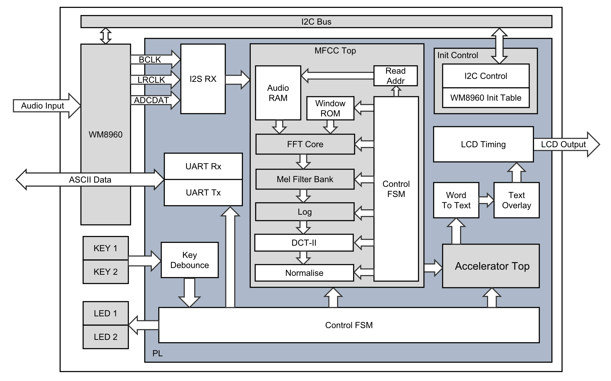
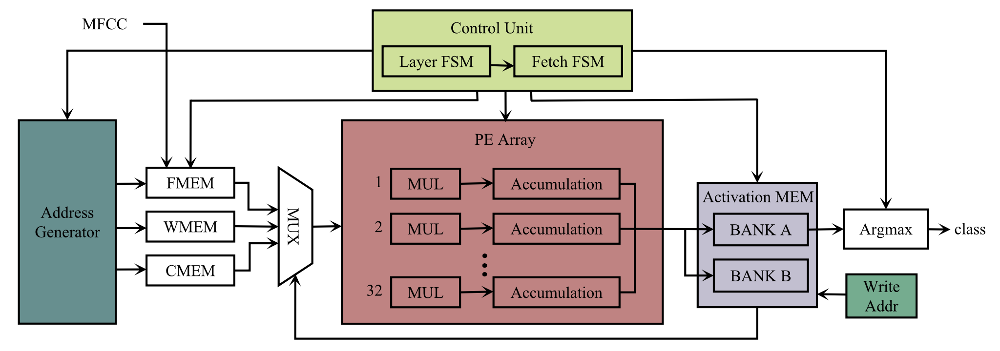

# 基于 FPGA 的实时关键词识别系统

在 Xilinx Artix-7 **XC7A100T-2FGG484** 上实现的一个完整关键词识别（Keyword Spotting）系统：**WM8960 → 片上 MFCC 前端 → INT8 DS-CNN 加速器 → argmax → UART / LCD**，全链路在一块 PA-StarLite 开发板上跑通，12 类（10 个关键词 + silence + unknown）实时识别。
设计以论文 BioCAS 2025[^1] 的 DS-CNN KWS 加速器为基线进行对比，在**单引擎、整层乒乓**的架构下把资源压到 2/3，同时推理延迟压到 1/10。

## 目录

1. [关键指标](#sec-1)
2. [系统架构](#sec-2)
3. [仓库结构](#sec-3)
4. [快速开始](#sec-4)
5. [设计要点](#sec-5)
6. [板级集成](#sec-6)
7. [验证结果](#sec-7)
8. [里程碑](#sec-8)
9. [已知限制与后续工作](#sec-9)
10. [文档索引](#sec-10)
11. [素材来源](#sec-11)

---

<a id="sec-1"></a>

## 1. 关键指标

<a id="sec-1-1"></a>

### 1.1 加速器本体 vs 论文

| 指标 | 本设计 | BioCAS 2025[^1] |
|---|---|---|
| LUT | **6,692** | 9,705 |
| FF | 3001 | 2355 |
| BRAM | 13.5 | 10.5 |
| DSP | 0 | 0 |
| **CNN 推理** | **27,035 cycles = 0.563 ms** | 6.1 ms |
| 时钟 | 48 MHz | 50 MHz |
| 精度 | **93.37%**（test） | 90.46% |
| 类别 | **12** | 11 |

加速器本体比论文 **小 31%**、推理快 **10.8×**。BRAM 多 3 块是由于模型设计与硬件架构设计差异造成的（见 [§1.3](#sec-1-3)）。

<a id="sec-1-2"></a>

### 1.2 整机（含片上 MFCC / UART / LCD）

| 指标 | 本设计（整机） |
|---|---|
| LUT | **9,587 (15.1%)**，综合后 9,780 |
| FF | 4,110 (3.2%) |
| BRAM | **17 (12.6%)** = 16×RAMB36 + 2×RAMB18 |
| DSP | 17 (7.1%) —— 全部在 MFCC 前端处理；PE 阵列采用移位计算，无 DSP 消耗 |
| 功耗 | **0.247 W** |
| 时序 | WNS **+3.751 ns**，0 failing endpoints |
| MFCC 前端 | 781,745 cycles = 16.3 ms（流式输入，仅消耗少量 LUT） |

逐模块开销（`scripts/util_hier.tcl`，只跑综合，约 2 分钟）：

| 模块 | LUT | BRAM | DSP |
|---|---|---|---|
| `u_accel` 加速器 | 6,692 | 13.5 | — |
| &nbsp;&nbsp;├ `pe_array`（16 lane） | 3,424 | — | — |
| &nbsp;&nbsp;├ `act_bank` | 1,144 | 8 | — |
| &nbsp;&nbsp;├ `conv_engine` | 442 | — | — |
| &nbsp;&nbsp;├ `argmax_tree` | 131 | — | — |
| &nbsp;&nbsp;└ `weight_rom` / `const_loader` / `fmem` | — | 4 / 1 / 0.5 | — |
| `u_mfcc` MFCC 前端 | 1,969 | 3.5 | **17** |
| `u_wm` WM8960 I2C 初始化 | 139 | — | — |
| `u_lcd` + `u_word` + `u_text` | 198 | — | — |
| `u_uart` / `u_i2s` / 按键 ×2 | 58 | — | — |
| 顶层胶合（FSM / 状态寄存器） | 721 | — | — |

- 精度：INT8 QAT 全整数推理 93.37% test，FP32 基线 94.28% (val) / 93.64% (test) → 量化代价 **0.27 个点**
- MFCC 比 CNN 慢两个数量级，但两者节拍对齐（一窗 1 s 音频，MFCC 边收边算），端到端从开始计算到输出打印 ≈ **18 ms**

<a id="sec-1-3"></a>

### 1.3 存储器对比（Memory Size vs BRAM）

| | Memory Size (KB) | BRAM 数量 |
|---|---|---|
| 本质 | 逻辑容量：实际存了多少数据 | 物理资源：占了几块硬核 |
| 粒度 | 连续量 | 离散（RAMB36 = 4.5 KB、RAMB18 = 2.25 KB）|
| 是否含浪费 | 否 | **是**（端口数、位宽粒度都会撑大占用）|

同一个设计恒有 `BRAM 数量 ≥ Memory Size / 4.5 KB`，所以两个指标不能互相替代，只能并列考虑。

**我们的存储器（加速器本体）**

| 存储器 | 深度 × 位宽 | 逻辑容量 | 物理占用 | 打包效率 |
|---|---|---|---|---|
| `act_bank`（2 bank 乒乓）| 2 × 512 × 256 bit | **32 KB** | 8 × RAMB36 = 36 KB | 89% |
| `weight_rom` | 512 × 256 bit | **16 KB** | 4 × RAMB36 = 18 KB | 89% |
| `const_loader`（bias + shift）| 524 × 32 bit | **2 KB** | 1 × RAMB36 = 4.5 KB | 46% |
| `fmem`（MFCC 特征图）| 2048 × 8 bit（未用地址被 Vivado 裁掉）| **2 KB** | 1 × RAMB18 = 2.25 KB | 89% |
| **合计** | | **≈52 KB** | **13.5 BRAM = 60.75 KB** | **86%** |

MFCC 前端另有约 8 KB 常量 ROM（旋转因子 / mel / log / DCT），占 3.5 BRAM。

测法（两种互相校验）：

```tcl
report_ram_utilization -file report/ram_util.rpt   # 逐块 RAM 的 depth / width / bits
report_utilization -hierarchical                   # 只要物理数量就用这个
```

**与论文相比**

| 指标 | 本设计 | 论文 | 结论 |
|---|---|---|---|
| Memory Size | ≈52 KB | 9.125 KB |  **5.7×**（劣）|
| BRAM 物理 | 13.5 | 10.5 |  **+29%**（劣）|
| LUT | 6,692 | 9,705 |  **−31%**（优）|
| 延迟 | 0.563 ms | 6.1 ms |  **10.8×**（优）|

值得注意的是：论文的 9.125 KB 装在 10.5 块 BRAM（47 KB 物理）里，**打包效率只有 19%**。
按物理资源看，两边的差距（13.5 vs 10.5）远小于容量差距（52 vs 9.125），故我们的资源利用率更高。虽然激活缓冲必须装下整层（32 KB），但换来的是「一个引擎 + 一张配置表」的数据通路（LUT 少 31%、延迟低 10.8×，见 [§5.2](#sec-5-2)-[§5.3](#sec-5-3)）。

---

<a id="sec-2"></a>

## 2. 系统架构

<a id="sec-2-1"></a>

### 2.1 软件部分

| Layer name | Feature size | Kernel size | Stride | Input channel | Output channel |
|---|---|---|---|---|---|
| Conv2D | 20x101 | 3×3 | 2 | 1 | 32 |
| DW 1 | 10x51 | 3×3 | 2 | 32 | 32 |
| PW 1 | 5x26 | 1x1 | 1 | 32 | 32 |
| DW 2 | 5x26 | 3×3 | 2 | 32 | 32 |
| PW 2 | 3x13 | 1x1 | 1 | 32 | 64 |
| DW 3 | 3x13 | 3×3 | 1 | 64 | 64 |
| PW 3 | 3x13 | 1x1 | 1 | 64 | 64 |
| DW 4 | 3x13 | 3×3 | 1 | 64 | 64 |
| PW 4 | 3x13 | 1x1 | 1 | 64 | 64 |
| GAP | 3x13 | — | — | 64 | 64 |
| FC | 1x1 | — | — | 64 | 12 |

<a id="sec-2-2"></a>

### 2.2 硬件部分

系统整体架构设计



加速器（accelerator_top）架构设计



<a id="sec-2-3"></a>

### 2.3 时钟与复位

| 时钟 | 频率 | 来源 | 用途 |
|---|---|---|---|
| `clk` | 48 MHz | MMCM CLKOUT0（600/12.5） | 全部逻辑 |
| `clk_pix` | 12.5 MHz | MMCM CLKOUT1（600/48） | LCD 时序（独立域） |
| `aud_bclk` | 1.536 MHz | WM8960 提供 | I2S 采样（异步域） |

跨域点只有三处：I2S→48 MHz（翻转位 + 2-FF）、48 MHz→像素域（**翻转位** + 3-FF）、以及按键消抖。

---

<a id="sec-3"></a>

## 3. 仓库结构

```
.
├── constrs/            # XDC 文件（引脚、时钟、异步时钟组）
├── docs/               # 文档产出
├── golden/             # 黄金对比数据
├── mem/                # 模型的权重、偏置、输入 ROM
├── rtl/
│   ├── cnn/            # 卷积加速器
│   ├── common/         # 常用模块
│   ├── lcd/            # LCD 显示相关
│   ├── memory/         # 各层权重和激活值缓存
│   ├── preprocessing/  # MFCC 处理前端
│   ├── wm8960/         # WM8960 初始化
│   ├── board_top.v     # 板级顶层（WM8960/I2S + 加速器 + UART + LCD + 按键）
│   └── kws_params.vh   # 模型导出的 RTL 参数
│
├── scripts/
│   ├── golden/gen_all.py # 重生成预处理侧 ROM 与黄金向量（顺序已内置）
│   ├── impl.tcl          # 综合 + 实现 + bitstream
│   ├── prog.sh           # 检测器件、下载、烧 flash
│   ├── program.tcl
│   ├── uart_rx.py        # 上位机解码（5 字节帧，带校验）
│   └── util_hier.tcl     # 仅综合的逐模块资源报告（2 分钟）
│
├── sim/
│   ├── tb/                 # 各模块的 testbench
│   ├── reference_model.py  # 加速器的 RTL 参数和权重生成
│   └── run.sh              # 一键仿真脚本
│
├── software/                 # 模型训练脚本（PyTorch）
├── pyproject.toml & uv.lock  # python 环境依赖（uv）
└── README.md                 # 项目说明
```

---

<a id="sec-4"></a>

## 4. 快速开始

安装依赖：`git`、`iverilog`、Vivado 2020.2+、`uv`、Python 3.10+
对于 `Arch Linux / CachyOS`，你只需要: 
```shell
sudo pacman -S --needed iverilog uv git
# 检查是否安装成功
iverilog -V | head -1
```

其他发行版请自行参考对应的安装方法。接着克隆到本地并安装 Python 虚拟环境（也可以使用系统自带，推荐使用虚拟环境，避免污染系统环境）：

```shell
git clone https://github.com/flyingyuya/FPGA-DS-CNN-KWS.git
cd FPGA-DS-CNN-KWS && uv venv --python 3.10

# 若需要重新训练模型，还需安装 PyTorch 等依赖包
uv sync
```

<a id="sec-4-1"></a>

### 4.1 直接上板

```shell
# 1) 仿真回归
bash sim/run.sh all # 单跑：pe | conv | top | fft | mel | log | dct | word | i2s | wm | mfcc | board

# 2) 综合 + 实现（约 5 分钟，输出 bitstream 与资源/时序/功耗报告）
vivado -mode batch -notrace -source scripts/impl.tcl

# 3) 下载 / flash
bash scripts/prog.sh detect     # 看器件是否在线
bash scripts/prog.sh            # 下载到 SRAM（掉电丢失）
# bash scripts/prog.sh flash      # 写 W25Q128（掉电保留）

# 4) 上位机看识别结果
uv run --project software python scripts/uart_rx.py             # 正常显示
# uv run --project software python scripts/uart_rx.py --raw       # 打印原始字节
# uv run --project software python scripts/uart_rx.py -p /dev/ttyUSB1
```

**操作方式**：`KEY1`按一次识别一次；`KEY2`切换连续识别（约 1 次/s）。`LED0` ~1.4 Hz 闪烁（不闪 = 时钟/复位没起来），`LED1` 快闪 = WM8960 未配置成功、常亮 = 正在计算、闪一下 = 一次计算完成。详见 `docs/bringup.md`。

<a id="sec-4-2"></a>

### 4.2 重新训练

当改动了模型结构、量化配置、MFCC 几何或数据集时必须按下面的顺序重新走一遍：

```
数据集 ─► FP32 训练 ─► QAT ─► 导出 mem/ + rtl/kws_params.vh ─► 黄金向量 ─► 回归
```

<a id="sec-4-2-1"></a>

#### 4.2.1 准备数据集

下载 Google Speech Commands v0.02[^2]（约 2.3 GB，只做一次），按官方协议划分 train/val/test，缓存原始音频并统计 MFCC 归一化参数（`mean`/`std`）：

```shell
uv run software/data_prepare.py

# 数据集想放在仓库外（多个变体共用一份下载）时：
KWS_DATA_ROOT=/data/gscd uv run software/data_prepare.py

# 只验证流水线是否跑得通（几秒，用合成单音，不能用来训模型）：
uv run software/data_prepare.py --synthetic
```

最终产物：
+ `software/data/speech_commands_v0.02/`：原始 wav 的 memmap 缓存；
+ `software/data/cache/`：划分索引与归一化统计。

<a id="sec-4-2-2"></a>

#### 4.2.2 训练 FP32 模型

训一个带 BatchNorm 的 DS-CNN（stem + 4×DS 块 + GAP + FC，默认 60 epoch、batch 128、LR 3e-3）：

```shell
uv run software/train.py --stage fp32
```

产物：`software/artifacts/dscnn_fp32.pt`。

想快速验证脚本是否能跑通，可以加 `--max-batches 20` 参数。

<a id="sec-4-2-3"></a>

#### 4.2.3 量化感知训练

把 BN 折进卷积权重、插入 fake-quant（权重 INT8 / 激活 UINT8），再微调 8 epoch（LR 5e-4，最后 3 个 epoch 冻结激活范围）。

**这一步同时强制执行硬件的数值契约**：`quantisation.py` 会把每层的权重步长投影成 `ρ · 2^{-S}` 的形式，通过移位来代替乘法器的相关操作（见 §5.1）：

```shell
uv run software/train.py --stage qat

# 也可以一次跑完两个阶段
uv run software/train.py --stage all
```

产物：`software/artifacts/dscnn_int8_qat.pt`（含折叠后的权重与标定好的激活范围）。

训练完建议立刻核对两件事：

```shell
# 1) 数值契约是否成立（逐层检查 weight_step 与 2^-S 的比值是否只差一个 rho）
uv run software/check_contract.py --split val

# 2) 精度对照：FP32 / BN折叠后 FP32 / QAT fake-quant / 位精确整数模型
uv run software/evaluate.py --split test
```

最后一行是**位精确整数模型**的结果（UINT8 MFCC → INT16 logits，与 RTL 逐位一致），代表着能否上板。

> 如果 `check_contract.py` 报出某层不满足约束，一般是训练的量化投影出了问题。如果整数模型的精度比 QAT fake-quant 掉超过 0.5 个点，要先查激活范围标定。

<a id="sec-4-2-4"></a>

#### 4.2.4 导出 `.mem` 文件

把训练结果导出成 RTL 真正加载的存储镜像，并同步更新几何/量化参数头文件：

```shell
uv run software/export_mem.py            # 只写到 artifacts/export/
uv run software/export_mem.py --install  # 写进仓库（覆盖 mem/ 与 rtl/）
```

`--install` 会覆盖这些位置：

| 输出 | 内容 |
|---|---|
| `mem/weights/w_all.mem` | 全部层的 INT8 权重（按 32 lane × 8 bit 打包成行）|
| `mem/bias/b_all.mem` | 折叠了 zero-point 与四舍五入的 24 位偏置 + 每通道移位量 |
| `mem/input/` | 上板自检用的 12 类特征图 |
| `golden/act_*.mem`、`golden/top_*.mem`、`golden/golden.json` | **CNN 侧的黄金向量**（逐层激活 + 顶层 class/logits）|
| `rtl/kws_params.vh` | 层表、通道数、`KWS_BANK_WORDS`、量化参数 |
| `docs/ml_report.json`、`docs/quant_summary.csv` | 精度与逐层量化摘要 |

导出脚本内部会做三方交叉验证（训练图 `QDSCNN.forward` / 批量整数模型 `IntDSCNN` /按 RTL 寻址方式重放打包镜像的 `replay()`），三者不一致会直接报错，所以它能保证「导出的 `.mem` 就是训练出来的那个模型」。

**还需要区分另一套黄金向量**：CNN 侧由 `export_mem.py` 负责，**预处理侧**（FFT / mel / log / DCT / MFCC）由 `scripts/golden/gen_all.py` 负责，只有当 MFCC 几何参数（`N_MELS`、`N_MFCC`、`WIN`/`HOP`、FFT 点数）改动过时才需要一起重跑：

```shell
# 当修改了 MFCC 几何参数时：
uv run scripts/golden/gen_all.py   # 依赖顺序已内置
#   产物：rtl/preprocessing/{fft_twiddle_rom,mel_rom,log_lut}.v
#         mem/preprocessing/{dct_coef,hann_q15,mfcc_norm}.mem
#         golden/{fft,mfcc}/

# 无论哪种情况，最后都要跑一次回归确认位精确
bash sim/run.sh all
```

> 通道数/特征尺寸后改变后，可以顺手看一下 `report/util_hier.rpt` 里的 `act_bank` 和 `weight_rom` 是否还放得下，由于 `KWS_BANK_WORDS` 是按「最大层输出向上取 2 的幂」自动推导的，容量变化会直接反映成 BRAM 数量变化。
> ```shell
> # 通过以下脚本获取 report/util_hier.rpt 报告
> vivado -mode batch -notrace -source scripts/util_hier.tcl
> ```

后续操作步骤同 [§4.1](#sec-4-1) 小节。

---

<a id="sec-5"></a>

## 5. 设计要点

<a id="sec-5-1"></a>

### 5.1 数值契约：只需要移位

量化后的常规做法是每层一个定点乘法器做 requantisation。本设计把它变成一个**纯移位**：

```
weight_step[oc] · s_in / s_out == 2^-S[oc]
```

即每层的步长必须满足 `weight_step[oc] = ρ · 2^-S[oc]`，**每层只有一个自由实数 ρ**。这条约束由 `quantisation.py` 在带 QAT 的训练里强制执行，代价实测只有 **0.14 个点**，换来的是：整条数据通路没有乘法器位宽问题、没有额外 DSP、时序干净。

另外两个技巧：

- **zero-point 折进 bias**：只在"越界读取返回 `zp_in`/0"的前提下成立，于是乘法器是 8×8 无符号
- **四舍五入折进 bias**：把 `2^(S-1)` 加进 bias，避免每个通道一个加法器

累加器 24 位有符号，`shift` 是 4 位字段（`SHIFT_MAX=15`）。推导见 `docs/quantisation-math.md`。

<a id="sec-5-2"></a>

### 5.2 一个引擎服务所有层类型

`conv_engine` 同时实现 std conv / depthwise / pointwise / GAP / FC，靠 `layer_cfg` 的配置表切换，而不是每层实例一个引擎：

| 方案 | LUT |
|---|---|
| 每层类型一个引擎（3,150 LUT） | ✗ |
| **一个统一引擎 + 层配置表** | **≈700 LUT** |

代价是**整层乒乓**：每层的输出必须整块存下来才能开始下一层（行缓冲省 BRAM 但要求数据流单向、无法在统一引擎里复用同一套地址逻辑）。

<a id="sec-5-3"></a>

### 5.3 两块 bank 合成一块存储器

激活双 bank 不再用两组存储器 + 256 位读多路器，而是**一块存储器 + bank 位占地址最高位**，读多路器彻底消失。`BANK_WORDS` 由「最大层输出 + 2 的幂向上取整」推导得出：

- 40 mel 频带：20×51 = 1020 → 1024
- **20 mel 频带：10×51 = 510 → 512** ← 激活 BRAM 直接减半

<a id="sec-5-4"></a>

### 5.4 流式 MFCC 前端

`win_hist` 只有 **512 个样本 = 一窗历史**（相邻帧重叠 480/512，所以本身不需要 1 s 帧缓冲），用 LUTRAM（44 个）实现，**0 BRAM**。每帧靠 `wcnt` 判断该窗口是否已经写满，写满后再启动，因此不需要快照/冻结机制：

```verilog
need   = frame*HOP + (WIN - NFFT/2)          // 用移位代替乘法（仿真提速 5×）
s_ready = (wcnt < NSAMP) && (wcnt < need + SLACK)   // SLACK = RING - WIN = 32
```

效果：BRAM 24.5 → 17，MFCC 781,745 cycles（16.3 ms），依然位精确。

<a id="sec-5-5"></a>

### 5.5 20 个 mel 频带系数（特征维度消融的结果）

在完全相同的训练配方下做了消融：

| 配置 | val | test |
|---|---|---|
| 40 频带 / 101 帧 / 10 ms | 94.31% | 93.90% |
| **20 频带 / 101 帧 / 10 ms** | **94.28%** | **93.64%** |
| 30 频带 / 65 帧 / 15.6 ms | 92.48% | 92.47% |
| 40 频带 / 41 帧 / 25 ms | 89.89% | — |
| 40 频带 / 50 帧 / 0.5 s | 84.7% | — |

结论：**频带数在 40 就饱和了**，但**时间分辨率**和**上下文长度**都重要（0.5 s 上下文 −9.1 点，25 ms 帧移 −4.4 点）。所以砍频带不砍时间 → 20 频带让 CNN 从 44,763 → **27,035 cycles**，精度只掉 0.26 点，激活存储 BRAM 减少一半。

---

<a id="sec-6"></a>

## 6. 板级集成

| 外设 | 实现 |
|---|---|
| WM8960 音频 codec | I2S 从机接收，16 kHz、16 bit、只取左声道；I2C 初始化寄存器 |
| UART | 115200 8N1，**5 字节帧**：`0xA5, class, margin_hi, margin_lo, checksum` |
| LCD | 480×272，24 位，**无 DE 脚**（只有 HS/VS）；面板接线 **BGR**，输出时交换 R/B |
| 按键 | 20 ms 消抖（低有效） |
| LED | 心跳 + 状态机指示（详见 `docs/bringup.md`） |

---

<a id="sec-7"></a>

## 7. 验证结果

**原则：位精确，不是容差。** 12 个套件全部与黄金模型逐位对比：

| 套件 | 内容 |
|---|---|
| `pe` | 992/992 lane 结果与黄金模型一致 |
| `conv` | 11 层全部一致 |
| `top` | 14 组向量，class + 12 个 logit 位精确 |
| `fft` | 6 组向量 × 256 bin |
| `mel` | 6 × 20 滤波器 |
| `log` | 6 × 20 |
| `dct` | 6 × 20 系数 |
| `mfcc` | 3 段语音 × 2020 codes 位精确 |
| `i2s` | 64/64 样本位精确，右声道丢弃 |
| `wm` | I2C 寄存器逐条一致 |
| `board` | 全链路：`yes` → class 2，margin 85；连续模式自动重启 |
| `word` | 触发→1 秒保持→silence 不显示 |

---

<a id="sec-8"></a>

## 8. 里程碑

| 阶段 | 内容 | 状态 |
|---|---|---|
| M0 | 数值契约（量化 + 黄金模型 + 位精确整数模型） | ✅ |
| M1 | PE array（992 lane 位精确） | ✅ |
| M2 | 统一 `conv_engine`（11 层位精确） | ✅ |
| M3 | 加速器顶层（argmax + 存储器合并） | ✅ |
| M4 | 真机 P&R（WNS 转正，bitstream 生成） | ✅ |
| M5 | 架构/资源调优（LUT 23,264 → 9,500） | ✅ |
| M6 | 片上 MFCC 前端（4 个模块位精确） | ✅ |
| M7 | 板级集成（WM8960 / I2S / UART / 按键） | ✅ |
| M8 | LCD 关键词显示（480×272 + 半透明底板） | ✅ |
| M9 | 桌面宠物（关键词驱动角色动画） | 分支 `feature/pet-demo` |

---

<a id="sec-9"></a>

## 9. 已知限制与后续工作

- 目前识别速度是 1 帧/s（无输入帧缓冲），若要做 200–250 ms 滑窗，需要`加窗重叠 + FMEM 环形列地址`，但同时也会增加 BRAM 资源消耗。
- 连续模式下每次 CNN 运行（0.563 ms）期间不采样本，占一帧的 0.06%，几乎可忽略。
- 当前在 12 类任务上的量化精度为 93.37%。

---

<a id="sec-10"></a>

## 10. 文档索引

| 文件 | 内容 |
|---|---|
| `docs/quantisation-math.md` | shift-only 量化契约的完整推导（含 ρ、zero-point、舍入） |
| `docs/memory-layout.md` | 每层特征图/权重的地址映射 |
| `docs/bringup.md` | 上板指南：引脚表、LED 真值表、flash 陷阱、按键说明 |

---

<a id="sec-11"></a>

## 11. 素材来源

- `software/`中的部分训练代码来自 cnn-kws-hardware-accelerator 项目[^3]。
- 其余 RTL 及验证环境全部为本项目原创。
- `rtl/lcd/font_rom.v`、`rtl/lcd/lcd_timing.v`、WM8960 I2C 初始化序列等移植自本人另一个项目 `Sonic-Speed-Parallelism`。


[^1]: Y. Xue, W. S. Ng, W. L. Goh, Y. Gao and S. Lee, "A Real-time Keyword Spotting Accelerator Using Depthwise Separable Convolutional Neural Network," 2025 IEEE Biomedical Circuits and Systems Conference (BioCAS), Abu Dhabi, United Arab Emirates, 2025, pp. 41-45, doi: 10.1109/BioCAS67066.2025.00020.
[^2]: P. Warden, Speech Commands: A Dataset for Limited-Vocabulary Speech Recognition, arXiv preprint, arXiv:1804.03209, 2018.
[^3]: <https://github.com/DabMouse/cnn-kws-hardware-accelerator>